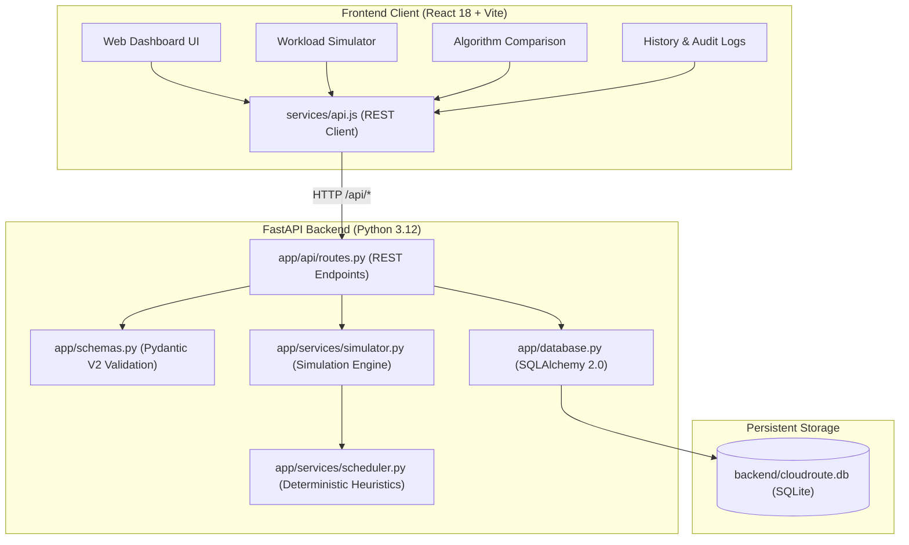

# CloudRoute AI — Intelligent Cloud Resource Allocation and Workload Optimization System

[](https://fastapi.tiangolo.com)
[](https://react.dev)
[](https://vitejs.dev)
[](https://www.sqlalchemy.org)
[](https://pytest.org)

An academic simulation platform designed for solving the multi-objective task scheduling problem in heterogeneous cloud computing environments. Built for 3rd-year Artificial Intelligence & Data Science coursework.

---

## 📑 Table of Contents

1. [Project Overview](#-project-overview)
2. [Problem Statement](#-problem-statement)
3. [Objectives](#-objectives)
4. [Key Features](#-key-features)
5. [Technology Stack](#-technology-stack)
6. [System Architecture](#-system-architecture)
7. [Directory Structure](#-directory-structure)
8. [Scheduling Algorithms](#-scheduling-algorithms)
9. [Mathematical Formulas & Simulation Assumptions](#-mathematical-formulas--simulation-assumptions)
10. [Sample Payloads & I/O Examples](#-sample-payloads--io-examples)
11. [REST API Documentation](#-rest-api-documentation)
12. [Installation & Windows PowerShell Setup](#-installation--windows-powershell-setup)
13. [Running the Application](#-running-the-application)
14. [Automated Testing Suite](#-automated-testing-suite)
15. [Demonstrating to a College Evaluator](#-demonstrating-to-a-college-evaluator)
16. [Common Errors & Solutions](#-common-errors--solutions)
17. [Current Assumptions & Academic Limitations](#-current-assumptions--academic-limitations)

---

## 🌐 Project Overview

Cloud computing data centers manage heterogeneous compute nodes (servers with varying CPU core counts, RAM capacities, and MIPS ratings) processing bursty, asynchronous user tasks. Assigning incoming tasks to nodes efficiently is an **NP-Hard combinatorial optimization problem**. 

**CloudRoute AI** provides a pure software virtualization and simulation testbed to model heterogeneous virtual machines, evaluate classical and load-aware scheduling heuristics, track cluster makespan and server balance, and audit experiment logs—all without requiring paid AWS/Azure/GCP cloud accounts or physical hardware.

---

## 🎯 Problem Statement

Given:
- A set of $M$ heterogeneous virtual cloud servers $S = \{s_1, s_2, \dots, s_M\}$, where each server $s_j$ has a finite processing capacity quota $C_j$ (Compute Units / MIPS).
- A batch of $N$ computational workload tasks $T = \{t_1, t_2, \dots, t_N\}$, where each task $t_i$ has a processing requirement $R_i$, priority level $P_i \in \{\text{High}, \text{Medium}, \text{Low}\}$, and arrival timestamp $A_i \ge 0$.

Determine a deterministic schedule mapping $f: T \to S$ that:
1. **Minimizes Makespan ($C_{\text{max}}$)**: The total wall-clock time required to complete all scheduled tasks.
2. **Minimizes Degree of Imbalance ($DI$)**: The variance in busy timelines across all virtual nodes to eliminate thermal hotspots and idle resource waste.
3. **Respects Finite Server Capacities**: $\sum_{t_i \in \text{Assigned}(s_j)} R_i \le C_j$ for all $s_j \in S$.
4. **Enforces Task Queue Precedence**: Tasks begin execution only after both the task has arrived ($A_i$) and the assigned server has finished previous queued jobs.

---

## 🎯 Objectives

- **Scientific & Academic Rigor**: Avoid synthetic or randomized performance metrics; display authentic empty states prior to simulations.
- **Deterministic Evaluation**: Ensure identical workload configurations produce repeatable, verifiable schedules across algorithm runs.
- **Comparative Benchmarking**: Execute all four heuristics synchronously against identical workloads to compare trade-offs directly.
- **Full Traceability**: Maintain a persistent SQLite audit history with structured JSON records of submitted workloads, server states, and task timelines.
- **Accessible Zero-Cost Architecture**: Run completely locally on Windows/Linux/macOS with zero paid third-party dependencies.

---

## ✨ Key Features

- **Interactive Workload Simulator**: Add, configure, and delete heterogeneous virtual servers and computational tasks with real-time capacity validation.
- **Four Operational Scheduling Heuristics**: Round Robin, Priority Scheduling, Best Fit, and Least Loaded.
- **Side-by-Side 4-Algorithm Benchmark**: Executes all heuristics on identical inputs and generates comparative tables and charts.
- **Interactive Visualizations (Recharts)**: Server Capacity vs. Used Load, Node Utilization % with status color-coding, Makespan comparisons, and Queue Waiting Time graphs.
- **Virtual Server Health Visualization**: Node cards with calculated statuses (`IDLE`, `NORMAL`, `HIGH LOAD`, `SATURATED`), remaining capacity headroom, and assigned task badges.
- **Audit History & Record Management**: View previous runs, inspect full schedule details in an interactive modal, and delete records with confirmation.
- **Full RESTful FastAPI Backend**: Validated by Pydantic V2 schemas with automatic OpenAPI Swagger UI at `/docs`.

---

## 🛠️ Technology Stack

| Component | Technology | Specification / Purpose |
| :--- | :--- | :--- |
| **Frontend Framework** | React 18 | Declarative single-page architecture with hooks |
| **Build Tool** | Vite 5.4 | Sub-second HMR and optimized production bundling |
| **Styling & Design System** | Vanilla CSS Tokens | Sleek Navy (`#0B132B`), Electric Blue (`#2563EB`), Emerald, Amber, and Crisp White |
| **Icons & Charts** | Lucide React, Recharts 2.13 | Vector UI icons and responsive interactive SVG charts |
| **Backend REST API** | Python 3.12, FastAPI | High-throughput REST API with OpenAPI Swagger UI |
| **Data Validation** | Pydantic V2 | Strict type enforcement, field boundary validators, and serializable schemas |
| **Persistence / ORM** | SQLite 3, SQLAlchemy 2.0 | Lightweight local database with structured JSON storage |
| **Automated Testing** | pytest 9.1, HTTPX TestClient | Automated unit, integration, and empty-state verification |

---

## 🏛️ System Architecture



---

## 📂 Directory Structure

```text
CloudRoute-AI/
├── backend/
│   ├── app/
│   │   ├── __init__.py
│   │   ├── main.py              # FastAPI app, CORS middleware, init_db() startup
│   │   ├── database.py          # SQLAlchemy SQLite connection, absolute path, migration
│   │   ├── models.py            # ORM models (VirtualServer, TaskWorkload, SimulationRun)
│   │   ├── schemas.py           # Pydantic V2 schemas for requests, responses & history
│   │   ├── api/
│   │   │   ├── __init__.py
│   │   │   └── routes.py        # /health, /simulate, /compare, /history, /dashboard/metrics
│   │   └── services/
│   │       ├── __init__.py
│   │       ├── scheduler.py     # Deterministic algorithms (RR, Priority, Best Fit, Least Loaded)
│   │       └── simulator.py     # SimulationEngine, metrics calculation, and validation
│   ├── tests/
│   │   ├── __init__.py
│   │   ├── conftest.py          # Isolated in-memory SQLite fixture for test repeatability
│   │   ├── test_health.py       # Health check and empty-state verification
│   │   ├── test_history.py      # History persistence, compare, inspect, and deletion tests
│   │   └── test_scheduler.py    # Unit tests for heuristics, formulas, and boundaries
│   ├── cloudroute.db            # Local SQLite database file (runtime generated)
│   └── requirements.txt         # Python dependencies
├── frontend/
│   ├── public/
│   ├── src/
│   │   ├── components/
│   │   │   ├── Sidebar.jsx      # Navigation sidebar with live backend health indicator
│   │   │   ├── Navbar.jsx       # Header bar with breadcrumbs and topology seed action
│   │   │   ├── StatCard.jsx     # Clean metric cards with honest empty states
│   │   │   └── EmptyState.jsx   # Contextual empty state component
│   │   ├── pages/
│   │   │   ├── DashboardPage.jsx   # Aggregate metric cards and operational heuristics summary
│   │   │   ├── SimulatorPage.jsx   # Workload configuration, execution, and Recharts charts
│   │   │   ├── ComparisonPage.jsx  # Live 4-algorithm benchmark, Recharts, and analysis
│   │   │   ├── HistoryPage.jsx     # Persistent run history, inspection modal & record deletion
│   │   │   └── AboutPage.jsx       # Project background and technical architecture
│   │   ├── services/
│   │   │   └── api.js           # Reusable fetch client connecting to FastAPI
│   │   ├── App.jsx              # Main tab orchestrator and notification system
│   │   ├── index.css            # Enterprise design tokens and styles
│   │   └── main.jsx             # React entrypoint
│   ├── index.html
│   ├── package.json             # Frontend dependencies (React, Recharts, Lucide)
│   └── vite.config.js           # Vite dev server with proxy to backend port 8000
├── README.md
└── .gitignore
```

---

## ⚙️ Scheduling Algorithms

| Algorithm | Category | Logic & Tie-Breaking | Best-Fit Scenario |
| :--- | :--- | :--- | :--- |
| **Round Robin (RR)** | Cyclic Capacity Dispatch | Distributes incoming tasks cyclically among eligible servers with capacity. Pointer advances on successful placement. | Homogeneous workloads where cyclic fairness prevents starvation. |
| **Priority Scheduling** | Priority Precedence | Sorts tasks by Priority (High > Medium > Low), then Arrival Time ($A_i$), then original index. Assigns to first eligible node. | SLA-driven multi-tenant cloud environments with latency-critical jobs. |
| **Best Fit** | Tightest Slack Heuristic | Assigns each task to the eligible node with the **smallest remaining capacity** (tightest fit, minimal leftover slack). Tie-breaks by server index. | Maximizing node space efficiency and conserving high-capacity nodes. |
| **Least Loaded** | Dynamic Load Balancer | Assigns each task to the eligible server with the **lowest normalized utilization** ($\frac{\text{Used}}{\text{Capacity}}$). Tie-breaks by remaining capacity. | Equalizing CPU saturation, heat dissipation, and minimizing cluster imbalance. |

---

## 📐 Mathematical Formulas & Simulation Assumptions

### 1. Task Execution Duration
$$\text{Duration} = \max\left(0.05, \text{round}\left(\frac{\text{Task Requirement } R_i}{\text{Server Capacity } C_j} \times 10.0, 2\right)\right) \text{ seconds}$$

### 2. Task Timeline & Queuing Delay
$$\text{Start Time}_i = \max(\text{Arrival Time } A_i, \text{Server Busy Timeline } \tau_j)$$
$$\text{Completion Time}_i = \text{Start Time}_i + \text{Duration}_i$$
$$\text{Waiting Time}_i = \text{Start Time}_i - \text{Arrival Time}_i$$
$$\text{Updated Server Timeline } \tau_j \leftarrow \text{Completion Time}_i$$

### 3. Total Cluster Makespan ($C_{\text{max}}$)
$$C_{\text{max}} = \max_{t_i \in T_{\text{alloc}}} (\text{Completion Time}_i)$$
*(Evaluates to `0.0s` if no tasks are allocated).*

### 4. Average Server Utilization ($U_{\text{avg}}$)
$$U_{\text{avg}} = \frac{1}{M} \sum_{j=1}^{M} \left( \frac{\text{Used Capacity}_j}{\text{Total Capacity}_j} \times 100\% \right)$$
*(Evaluates to `0.0%` if $M = 0$).*

### 5. Degree of Imbalance ($DI$)
$$DI = \frac{\tau_{\text{max}} - \tau_{\text{min}}}{\tau_{\text{avg}}}$$
where $\tau_j$ is the final busy timeline of server $j$, $\tau_{\text{max}} = \max_j(\tau_j)$, $\tau_{\text{min}} = \min_j(\tau_j)$, and $\tau_{\text{avg}} = \frac{1}{M} \sum_{j=1}^M \tau_j$.
- Lower values indicate balanced load dissipation.
- **Division-by-Zero Safety**: If $\tau_{\text{avg}} = 0$ (all servers idle), $DI = 0.0000$.

---

## 📦 Sample Payloads & I/O Examples

### Request: Single Algorithm (`POST /api/simulate`)
```json
{
  "algorithm": "least_loaded",
  "servers": [
    { "name": "vm-general-s1", "capacity": 1000.0 },
    { "name": "vm-compute-c1", "capacity": 2500.0 },
    { "name": "vm-memory-m1", "capacity": 1500.0 }
  ],
  "tasks": [
    { "name": "Task-Web-Frontend", "requirement": 300.0, "priority": "High", "arrival_time": 0.0 },
    { "name": "Task-Data-ETL", "requirement": 1200.0, "priority": "Medium", "arrival_time": 0.5 },
    { "name": "Task-ML-Inference", "requirement": 2500.0, "priority": "High", "arrival_time": 1.0 }
  ]
}
```

### Response: Single Algorithm
```json
{
  "simulation_id": "sim-4e8c1b29",
  "mode": "single",
  "result": {
    "algorithm_key": "least_loaded",
    "algorithm_name": "Least Loaded",
    "total_tasks": 3,
    "allocated_tasks": 3,
    "unallocated_tasks": 0,
    "makespan_seconds": 11.0,
    "avg_server_utilization": 58.67,
    "avg_waiting_time": 0.0,
    "load_imbalance": 0.8182,
    "execution_time_ms": 1.25,
    "servers": [
      {
        "name": "vm-general-s1",
        "total_capacity": 1000.0,
        "used_capacity": 300.0,
        "remaining_capacity": 700.0,
        "utilization_percentage": 30.0,
        "assigned_tasks": ["Task-Web-Frontend"]
      }
    ],
    "tasks": [
      {
        "task_name": "Task-Web-Frontend",
        "priority": "High",
        "requirement": 300.0,
        "arrival_time": 0.0,
        "assigned_server": "vm-general-s1",
        "start_time": 0.0,
        "completion_time": 3.0,
        "execution_duration": 3.0,
        "waiting_time": 0.0,
        "status": "Allocated"
      }
    ]
  }
}
```

---

## 📡 REST API Documentation

| Method | Route | Description |
| :--- | :--- | :--- |
| `GET` | `/api/health` | Service health status, version, and database connectivity. |
| `GET` | `/api/dashboard/metrics` | Real-time aggregate statistics from SQLite (honest empty state when unsimulated). |
| `POST` | `/api/simulate` | Executes a workload simulation using a selected heuristic (`round_robin`, `priority`, `best_fit`, `least_loaded`, or `all`), saves the run to SQLite, and returns details. |
| `POST` | `/api/compare` | Executes all 4 heuristics on the identical workload and returns side-by-side metrics. |
| `GET` | `/api/history` | Returns saved simulation run summaries ordered by timestamp descending. |
| `GET` | `/api/history/{simulation_id}` | Retrieves complete details (workload config, server results, task schedule, and metrics) for a given run ID. Returns 404 if not found. |
| `DELETE` | `/api/history/{simulation_id}` | Deletes the specified simulation record from the SQLite database. Returns 404 if not found. |
| `GET` | `/api/sample-workload` | Returns standard benchmark servers (4 nodes) and tasks (6 heterogeneous jobs). |
| `POST` | `/api/seed-default-resources` | Seeds 4 default virtual server configurations into the database. |

---

## 💻 Installation & Windows PowerShell Setup

### 1. Prerequisites
- **Python 3.10+** (Tested on Python 3.12)
- **Node.js 18+** and **npm**

---

### 2. Backend Setup (Windows PowerShell)

Open a PowerShell terminal in the project root:

```powershell
# 1. Navigate to backend directory
cd backend

# 2. Create virtual environment (if not already created)
python -m venv .venv

# 3. Activate virtual environment
.\.venv\Scripts\Activate.ps1

# Note: If script execution is restricted on your machine, run:
# Set-ExecutionPolicy -Scope Process -ExecutionPolicy Bypass

# 4. Install dependencies
pip install -r requirements.txt
```

---

### 3. Frontend Setup (Windows PowerShell)

In a separate PowerShell terminal:

```powershell
# 1. Navigate to frontend directory
cd frontend

# 2. Install Node dependencies
npm install
```

---

## 🚀 Running the Application

### 1. Start the Backend Server

In your backend terminal with the virtual environment activated:

```powershell
uvicorn app.main:app --reload --port 8000
```

- **Interactive API Documentation (Swagger UI)**: [http://127.0.0.1:8000/docs](http://127.0.0.1:8000/docs)
- **Alternative ReDoc Documentation**: [http://127.0.0.1:8000/redoc](http://127.0.0.1:8000/redoc)
- **Health Check Endpoint**: [http://127.0.0.1:8000/api/health](http://127.0.0.1:8000/api/health)

---

### 2. Start the Frontend Development Server

In your frontend terminal:

```powershell
npm run dev
```

Open [http://localhost:5173](http://localhost:5173) in your web browser.

To verify a production build:

```powershell
npm run build
```

---

## 🧪 Automated Testing Suite

From the project root:

```powershell
python -m pytest backend/tests -v
```

All **26 automated tests** validate:
- Root & `/api/health` availability.
- Honest initial unsimulated empty states.
- Deterministic repeatability of scheduling heuristics.
- Strict enforcement of server capacity limits (tasks never exceed node quotas).
- Correct explanatory reasons for unallocated tasks.
- Boundary condition validation (rejection of zero/negative capacity, invalid priorities, and negative arrival times).
- Comparative benchmarking endpoint (`POST /api/compare`).
- SQLite persistence, detail retrieval (`GET /api/history/{id}`), and safe record deletion (`DELETE /api/history/{id}`).
- Division-by-zero resilience on edge-case empty workloads.

---

## 🎓 Demonstrating to a College Evaluator

Follow this step-by-step presentation script to demonstrate the project:

1. **Step 1: System Health & Honest Empty State**
   - Open [http://localhost:5173](http://localhost:5173).
   - Point out the green **"Backend Operational"** badge in the sidebar.
   - Show the **Dashboard**: Highlight that before running simulations, Average Utilization and Makespan honestly display `—` empty states rather than fake or randomized numbers.

2. **Step 2: Initialize Virtual Cloud Topology**
   - Click **"Initialize Default Topology"** in the top navigation bar.
   - Show that 4 heterogeneous software-simulated virtual servers appear in the pool (`vm-general-s1`, `vm-compute-c1`, `vm-memory-m1`, `vm-gpu-accel-g1`).

3. **Step 3: Workload Simulation & Recharts Visualizations**
   - Navigate to the **Workload Simulator** tab.
   - Click **"Load Sample Workload"** to populate balanced heterogeneous tasks.
   - Select **"Least Loaded"** and click **"Run Simulation"**.
   - Show the resulting **Virtual Server Cards**:
     - Emphasize the calculated status badge (`NORMAL`, `HIGH LOAD`, `SATURATED`).
     - Point out the used vs. remaining capacity and assigned task pills.
   - Show the interactive **Recharts graphs**:
     - Bar chart comparing Capacity vs. Used Load per server.
     - Utilization % bar chart with dynamic color-coding.
   - Show the **Task Schedule Table**:
     - Explain how $\text{Duration} = \left(\frac{R_i}{C_j}\right) \times 10.0$ and $\text{Wait} = \text{Start} - \text{Arrival}$.

4. **Step 4: Capacity Limit Violation & Unallocated Task Reasons**
   - Add a task requiring `6000 CU` (greater than any single server capacity).
   - Run the simulation again.
   - Show that the task is marked **Unallocated** and that the table displays the exact scientific reason: *"Insufficient capacity on all servers"*.

5. **Step 5: Comparative Benchmarking Across All 4 Heuristics**
   - Navigate to the **Algorithm Comparison** tab.
   - Click **"Re-run Comparison Benchmark"**.
   - Show that all four algorithms (Round Robin, Priority, Best Fit, Least Loaded) ran against the exact same task queue.
   - Highlight the **Dynamic Workload-Specific Analysis**:
     - Explain why a particular algorithm achieved the lowest makespan for this workload.
     - Point out the academic note explaining that **no single scheduling algorithm is universally best**—heuristics represent engineering trade-offs between latency, packing efficiency, and load leveling.

6. **Step 6: SQLite Audit History & Inspection Modal**
   - Navigate to the **Simulation History** tab.
   - Show that every run has been saved to SQLite with its unique `simulation_id` and timestamp.
   - Click **"View"** on any run to open the detailed inspector modal, showing the saved task schedule and historical Recharts chart.
   - Click **"Del"** on a run, accept the browser confirmation prompt, and demonstrate that the record is cleanly deleted from SQLite.

7. **Step 7: OpenAPI Swagger Documentation**
   - Open [http://127.0.0.1:8000/docs](http://127.0.0.1:8000/docs).
   - Demonstrate the auto-generated Swagger UI documenting `/api/health`, `/api/simulate`, `/api/compare`, and `/api/history`.

---

## 🛠️ Common Errors & Solutions

| Issue | Root Cause | Solution |
| :--- | :--- | :--- |
| **`ExecutionPolicy` error in PowerShell** | Windows PowerShell blocks unsigned scripts by default. | Run: `Set-ExecutionPolicy -Scope Process -ExecutionPolicy Bypass` in your PowerShell session before activating `.venv`. |
| **`Connection refused` on frontend requests** | Backend Uvicorn server is not running on port 8000. | Ensure `uvicorn app.main:app --port 8000` is running in a terminal. |
| **Port 8000 already in use** | A dangling Python or Uvicorn process is occupying port 8000. | In PowerShell, find and kill the process: `Get-Process python \| Stop-Process` or use `uvicorn app.main:app --port 8001` and update `frontend/vite.config.js`. |
| **`422 Unprocessable Entity` on simulation** | Request payload missing required fields or negative capacity. | Verify that all server capacities and task requirements are strictly greater than zero. |
| **`404 Not Found` when retrieving history** | Simulation ID was deleted or does not exist in the database. | Refresh `/api/history` to retrieve active run IDs. |

---

## ⚠️ Current Assumptions & Academic Limitations

1. **Pure Local Software Virtualization**: The system models heterogeneous virtual cloud resources purely in software. It does **not** deploy live virtual machines on AWS, Azure, or GCP, incurring zero physical hardware or cloud billing costs.
2. **Static Capacity Quotas**: Server processing capacities represent static compute allocations during each simulation cycle; dynamic physical CPU frequency throttling (DVFS) is abstracted into deterministic MIPS equivalents.
3. **Non-Preemptive Scheduling**: Tasks run to completion once started on a node without preemption or thread-swapping overhead.
4. **Single-Node Execution Sandbox**: The simulation runs within a single SQLite-backed local workstation process designed for research and educational benchmarking rather than multi-datacenter distributed synchronization.
